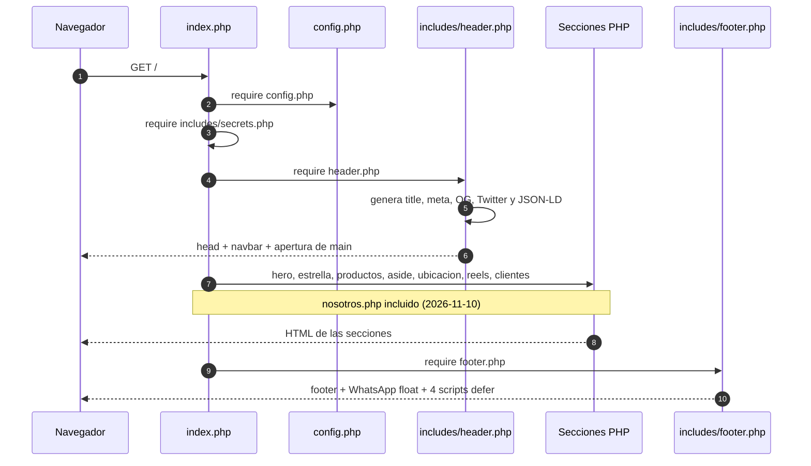
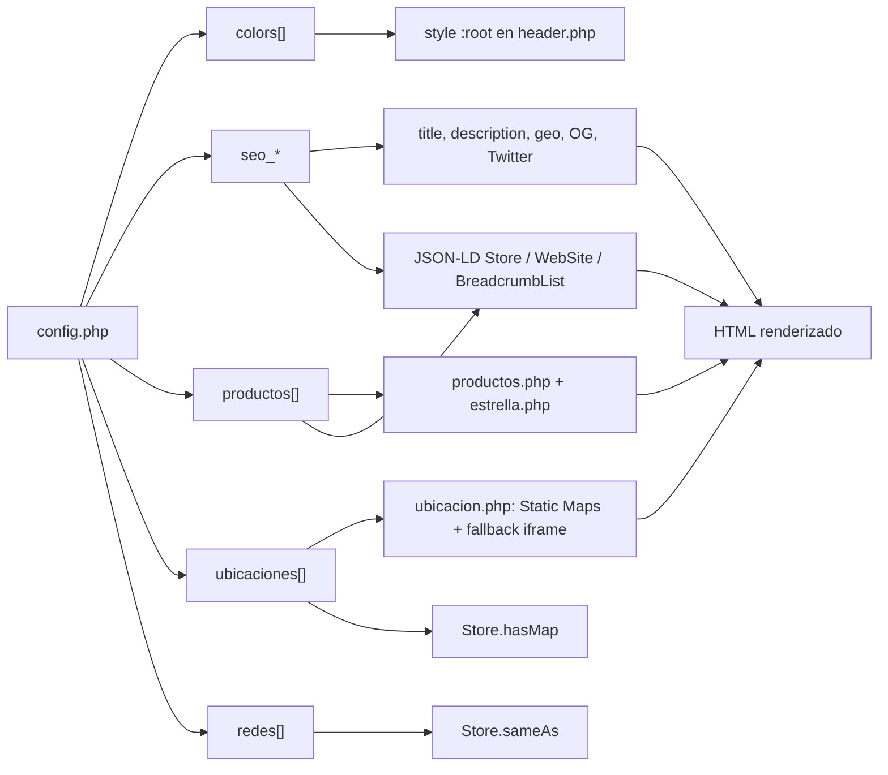

# Arquitectura — EZ Nutrifit

Landing single-page en PHP plano: `index.php` arma el documento, `config.php` es la fuente única de datos y `includes/` contiene header, footer y secciones; el CSS modular se compila a `assets/css/styles.css` con `tools/build-css.php`.

## Mapa rápido

| Ruta | Responsabilidad |
|---|---|
| `index.php` | Entry point: requiere `config.php`, `includes/secrets.php`, header, 7 secciones y footer. |
| `config.php` | Fuente única de verdad: datos del negocio, colores, productos, ubicaciones, SEO y redes. |
| `includes/header.php` | `<head>` completo, metadatos SEO, Open Graph, Twitter Card, JSON-LD, CSS crítico inline y navbar. |
| `includes/footer.php` | Footer MiLocalWeb, botón volver arriba, WhatsApp float y los 4 scripts con `defer`. |
| `includes/sections/hero.php` | Hero con 4 layouts; en este cliente usa `split`. |
| `includes/sections/estrella.php` | Producto estrella hardcodeado (Combo Explosivo). |
| `includes/sections/productos.php` | Hasta 3 productos destacados desde `config.php`. |
| `includes/sections/aside.php` | Aside publicitario de MiLocalWeb. |
| `includes/sections/ubicacion.php` | 4 puntos de venta; Static Maps con fallback a iframe. |
| `includes/sections/reels.php` | 3 videos locales con posters y `preload="none"`. |
| `includes/sections/nosotros.php` | Quiénes somos, founder, marcas, galería, redes y CTA. Incluida en `index.php` desde 2026-11-10. |
| `includes/sections/clientes.php` | Sección "Otros Clientes"; retorna si `mostrar_clientes` es `false`. |
| `assets/css/` | 7 fuentes base + `critical.css`; `styles.css` es el bundle generado. |
| `assets/css/sections/` | 6 parciales que reemplazan al antiguo `sections.css`: `01-shared`, `02-estrella`, `03-reels`, `04-productos`, `05-ubicacion`, `06-nosotros`. |
| `assets/fonts/` | `fonts.css` + 4 woff2 auto-hosteados. |
| `assets/js/` | `back-to-top.js`, `navbar.js`, `smooth-scroll.js`, `reels.js` (vanilla). |
| `assets/img/` | Imágenes del cliente, MiLocalWeb, terceros y SVG inline. |
| `assets/vid/reels/` | 3 mp4 + 3 posters webp. |
| `tools/build-css.php` | Build del bundle CSS; no se ejecuta en runtime. |
| `docs/` | Ficha, guías, informes históricos y esta documentación. |
| `skills/milocalweb-landing/` | Skill con convenciones y checklist del template. |

## Diagrama de dependencias

```mermaid
flowchart TD
    A["index.php"] --> B["config.php"]
    A --> C["includes/secrets.php"]
    A --> D["includes/header.php"]
    D --> E["assets/css/critical.css"]
    D --> F["assets/fonts/fonts.css"]
    D --> G["assets/css/styles.css"]
    H["tools/build-css.php"] -.->|"genera"| G
    H --> I["assets/css/base.css ... responsive.css"]
    H --> I2["assets/css/sections/01-shared.css ... 06-nosotros.css"]
    A --> J["includes/sections/hero.php"]
    A --> K["includes/sections/estrella.php"]
    A --> L["includes/sections/productos.php"]
    A --> M["includes/sections/aside.php"]
    A --> N["includes/sections/ubicacion.php"]
    A --> O["includes/sections/reels.php"]
    A --> P["includes/sections/clientes.php"]
    A --> Q["includes/footer.php"]
    Q --> R["assets/js/*.js"]
    D --> S["JSON-LD @graph"]
    T["includes/sections/nosotros.php"]
    A -->|"incluido"| T
    classDef missing fill:#fdd,stroke:#c00,color:#900
```



## Flujo de un request



## Flujo de datos



## CSS y JS

### CSS

- **Fuente y orden real del build:** `tools/build-css.php:23-39` lista 13 archivos en este orden: `base.css`, `navbar.css`, `hero.css`, `sections/01-shared.css`, `sections/02-estrella.css`, `sections/03-reels.css`, `sections/04-productos.css`, `sections/05-ubicacion.css`, `sections/06-nosotros.css`, `aside.css`, `clientes.css`, `footer.css`, `responsive.css`.
- **Bundle generado:** `assets/css/styles.css` (1 línea física, 29.183 bytes, SHA-256 `79E66D6C8C77DCE2142A7F09770DAF4BAB8719F1E143DAD8228C274449BDDB0A`). Es un artefacto de build: **no editarlo a mano**.
- **Critical CSS:** `assets/css/critical.css` (400 líneas) se inyecta inline en `includes/header.php:286-289`. No pasa por el bundle ni requiere rebuild al editarlo.
- **Fuentes:** `assets/fonts/fonts.css` + 4 woff2; carga asíncrona con `preload + onload` (`includes/header.php:283-284`).
- **Lista muerta:** `index.php:32-46` conserva `$cssSourceFiles`, que ya no se usa para renderizar; el orden efectivo vive en `tools/build-css.php` (P2-11).
- **Comando obligatorio tras tocar CSS modular:**

  ```bash
  php tools/build-css.php
  ```

- **No hay** preprocesadores, `package.json`, bundler ni build de JS en el proyecto; `node --check` se usó solo como verificación sintáctica.

### JS

- 4 archivos vanilla cargados al final del body con `defer`: `back-to-top.js`, `navbar.js`, `smooth-scroll.js`, `reels.js` (`includes/footer.php:120-122`).
- Cache busting por `filemtime()` en `index.php:57-65` y `includes/footer.php:121`.
- Sin jQuery, frameworks ni CDNs. `node --check` se usó solo como verificación sintáctica, no como build.

## Invariantes

- `config.php` es la fuente única de verdad; si un dato no está ahí, no debería aparecer en la landing.
- No editar `assets/css/styles.css` ni bundles generados a mano.
- Mantener el orden de las 13 fuentes CSS; el orden preserva la cascada original.
- `critical.css` se sirve inline; `styles.css` se sirve async con `preload + onload`.
- Mantener el orden de las secciones de `index.php:72-78` salvo que se documente el cambio.
- No versionar `includes/secrets.php`; está ignorado en `.gitignore:14`.
- Usar variables CSS `--color-*` y `htmlspecialchars()` en la salida de datos del cliente.
- `nosotros.php` quedó incluido el 2026-11-10; el founder y las 8 marcas ya tienen contraparte visible.

## Cómo trabajar con IA

1. Leer `AGENTS.md` de la raíz.
2. Leer `docs/estado-actual.md` y este archivo.
3. Leer `config.php` antes de tocar cualquier sección.
4. Si se toca CSS modular, correr `php tools/build-css.php` y verificar el hash.
5. Verificar con `php -l` y una captura HTTP local.
6. No corregir P1/P2 de `estado-actual.md` sin pedido explícito: el alcance documental no incluye cambios de producto.
7. No editar `assets/css/styles.css` directamente ni agregar dependencias externas.

## Riesgos estructurales

- **Header monolítico:** `includes/header.php` (347 líneas) concentra SEO, Open Graph, JSON-LD, CSS crítico y navbar; un cambio de datos puede afectar varias capas.
- **Sección incluida:** `nosotros.php` se renderiza y muestra founder/marcas desde config.
- **JSON-LD condicionado a imágenes:** `header.php:81-84` salta categorías sin imagen; hoy se pierden 5 de 12.
- **Duplicación de CSS crítico:** `critical.css` repite navbar, hero y breakpoints de `responsive.css`; el mantenimiento puede derivar.
- **Host header:** canonical, OG y base del JSON-LD se derivan de `HTTP_HOST` (`header.php:25-26`), sin dominio fijo ni escape.
- **Exposición de archivos internos:** `.htaccess:33` no bloquea `config.php`, `docs/`, `tools/`, `skills/` ni `.git`; la auditoría confirmó `docs/ficha-cliente.md` por HTTP 200.
- **Documentación histórica desactualizada:** los informes SEO y Lighthouse describen un estado anterior (15 Products, iframes). `AR-X` sí es correcto para Córdoba.
- **Sin 404:** el servidor embebido devuelve 200 con la home para rutas inexistentes; no hay `ErrorDocument`.
