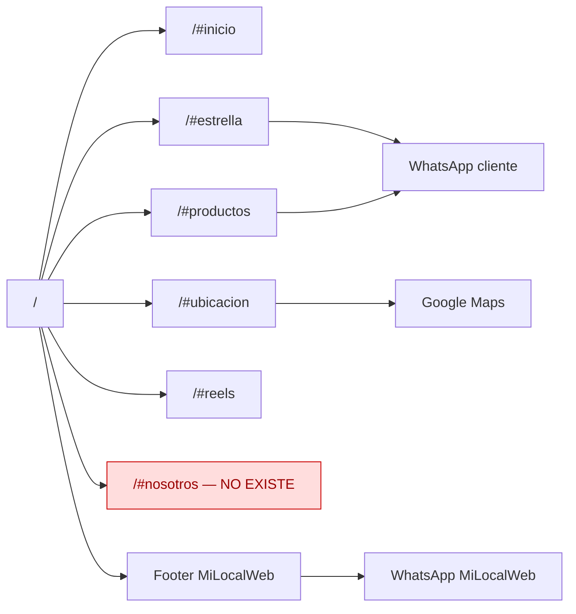

# Mapa del sitio — EZ Nutrifit

Sitio single-page: todo el contenido vive en `/` y se navega por anclas. No hay rutas de producto, carrito ni páginas internas.

## URLs y rutas

| URL | Archivo/route | Propósito | Indexable | Canonical | Estado |
|---|---|---|---|---|---|
| `/` | `index.php` | Landing completa | Sí | `https://eznutrifit.milocalweb.com.ar/` en producción; `https://127.0.0.1:8102/` en local | 200 `text/html` (82.717 bytes) |
| `/#inicio` | `index.php` | Hero | Sí | Idem `/` | 200 (mismo documento) |
| `/#estrella` | `index.php` | Producto estrella | Sí | Idem `/` | 200 (mismo documento) |
| `/#productos` | `index.php` | Productos destacados | Sí | Idem `/` | 200 (mismo documento) |
| `/#ubicacion` | `index.php` | Puntos de venta | Sí | Idem `/` | 200 (mismo documento) |
| `/#reels` | `index.php` | Videos | Sí | Idem `/` | 200 (mismo documento) |
| `/#nosotros` | `includes/sections/nosotros.php` | Quiénes Somos | Sí | Canonical home | 200 / anchor existe (2026-11-10) |
| `/assets/css/styles.css` | `assets/css/styles.css` | Bundle CSS generado | No | — | 200 `text/css` (29.183 bytes) |
| `/assets/css/critical.css` | `assets/css/critical.css` | Fuente del critical; se inlinea en el header | No | — | 200 `text/css` (400 líneas) |
| `/assets/js/navbar.js` | `assets/js/navbar.js` | Menú mobile | No | — | 200 `application/javascript` (1.285 bytes) |
| `/assets/js/reels.js` | `assets/js/reels.js` | Reproducción de reels | No | — | 200 `application/javascript` (1.315 bytes) |
| `/assets/fonts/fonts.css` | `assets/fonts/fonts.css` | Fuentes auto-hosteadas | No | — | 200 `text/css` |
| `/robots.txt` | `robots.txt` | Robots | N/A | — | 200 `text/plain` (336 bytes) |
| `/sitemap.xml` | `sitemap.xml` | Sitemap | N/A | — | 200 `application/xml` (1.804 bytes) |
| `/config.php` | `config.php` | Configuración | No | — | 200 vacío en PHP embebido; `.htaccess:33` **no** lo bloquea (P1-11) |
| `/includes/secrets.php` | `includes/secrets.php` | Secretos | No | — | 200 vacío en PHP embebido; con Apache, `.htaccess:33` bloquea `includes/` (esperado 403) |
| `/docs/ficha-cliente.md` | `docs/ficha-cliente.md` | Documento interno | No (robots) | — | 200 `text/markdown` (10.433 bytes) — servido públicamente; P2-08 |
| `/ruta-inexistente-audit-xyz` | Fallback del servidor embebido | Soft 404 | No | — | 200 con cuerpo idéntico a `/`; producción no verificable (P2-15) |
| `https://maps.googleapis.com/...staticmap...` | API externa | Mapa estático de cada punto | No | — | 200 `image/png` (27.732 bytes) con la key de `includes/secrets.php` |

> Los códigos y tamaños provienen de la auditoría del 2026-11-09. El servidor embebido de PHP no aplica `.htaccess`; los bloqueos y headers deben validarse en Apache.

## Diagrama de navegación

## Sitemap XML

- Existe: [sitemap.xml](../sitemap.xml).
- 1 URL: `https://eznutrifit.milocalweb.com.ar/`.
- `lastmod` fijo: `2026-08-07` (`sitemap.xml:7`).
- 6 imágenes (`sitemap.xml:13-36`): logo, hero, 3 productos y 1 imagen de impacto.
- Declara `geo:format=georss` (`sitemap.xml:10-12`) pero **sin latitud ni longitud**; la auditoría verificó `has_latitude=no` y `has_longitude=no`.
- Faltan imágenes de categorías y la OG image.
- `robots.txt` declara el sitemap en `robots.txt:6` y bloquea `config.php`, `includes/`, `docs/` y `skills/` en `robots.txt:9-12`.

## Anclas internas

| Ancla | Sección | Enlace desde |
|---|---|---|
| `#inicio` | Hero (`includes/sections/hero.php:25`) | Navbar (`includes/header.php:334`) |
| `#estrella` | Producto estrella (`includes/sections/estrella.php:21`) | Navbar (`includes/header.php:335`) |
| `#productos` | Productos (`includes/sections/productos.php:19`) | Navbar (`includes/header.php:336`); BreadcrumbList JSON-LD (`header.php:173`) |
| `#ubicacion` | Ubicación (`includes/sections/ubicacion.php:92`) | Navbar (`includes/header.php:337`); BreadcrumbList JSON-LD (`header.php:179`) |
| `#reels` | Reels (`includes/sections/reels.php:35`) | Navbar (`includes/header.php:338`) |
| `#nosotros` | Renderizado en `includes/sections/nosotros.php` | Navbar |

## Enlaces internos y observaciones

- **5/5 anchors válidos:** `#inicio`, `#estrella`, `#productos`, `#ubicacion` y `#reels` tienen destino; 0 rotos.
- **`/#nosotros` existe:** la sección se incluye en `index.php` y el navbar la enlaza desde 2026-11-10.
- **Marca del navbar:** el logo enlaza a `#` (`header.php:318`); `smooth-scroll.js:13-16` lo interpreta como "volver arriba", no como ruta rota.
- **Soft 404:** una ruta inexistente devuelve 200 con la home en el servidor embebido; no hay `ErrorDocument` (P2-15).
- **Documentos internos públicos:** `robots.txt` bloquea el rastreo de `/docs/`, pero no impide el acceso HTTP; la auditoría obtuvo 200 de `docs/ficha-cliente.md` (P2-08).
- **`config.php` accesible:** la regla de `.htaccess:33` no cubre `config.php`; el archivo se ejecuta y devuelve vacío en el servidor embebido, pero no tiene defensa en profundidad (P1-11).
- **Canonical dependiente del host:** `header.php:25-26` arma la base con `HTTP_HOST`; en local el canonical apunta a `https://127.0.0.1:8102/` (P2-12).
- **Sitemap mínimo:** al ser single-page, 1 URL es suficiente, pero el `lastmod` fijo y la falta de coordenadas/imágenes lo vuelven parcial (P2-01).
